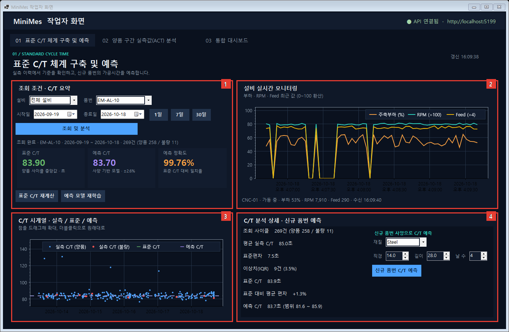
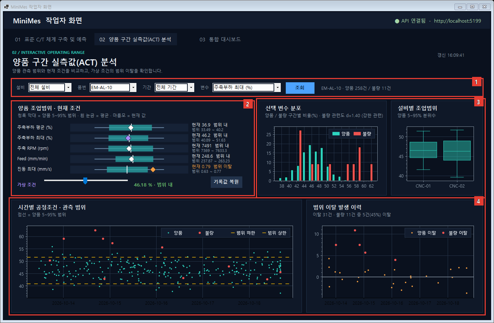
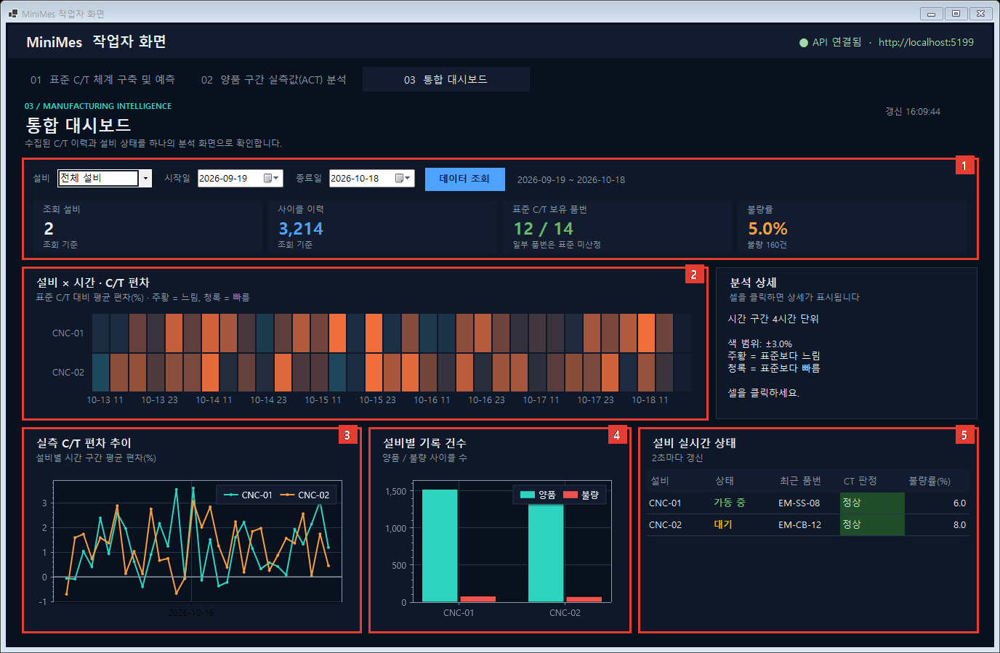
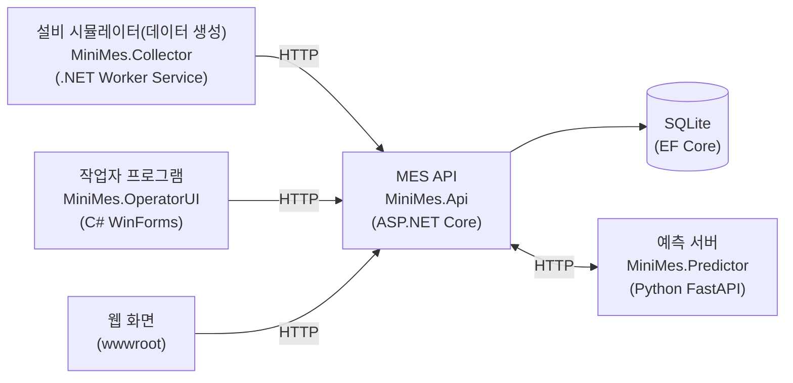
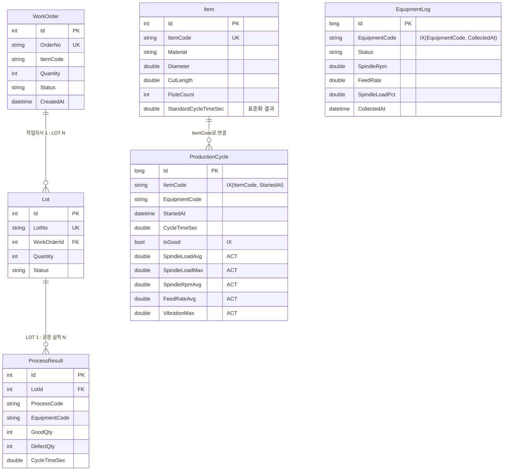

# MiniMes — 절삭공구 생산 라인 미니 MES

제조 현장에서 MES 연동, LOT 추적, Cycle Time 표준화, 공정 변수 분석을 다루며 겪은 문제를 **.NET 스택으로 새로 구현한 프로젝트**입니다.

실제 회사의 공정 데이터는 외부에 공개할 수 없어서, 품목·설비·생산 이력 데이터는 **직접 생성했습니다.** 재질별 가공시간 차이, 셋업 지연 같은 이상치, 불량 시 부하·진동 증가처럼 현장에서 나타나는 특성을 반영해 만들었고, 회사의 실제 데이터, 코드, 시스템 구조는 사용하지 않았습니다.

설비 데이터를 수집하고, 작업자가 보는 화면에서 아래 세 가지를 다룹니다.

| 목표 | 구현 |
|---|---|
| 1. 기존 품목 Cycle Time 표준화 | 양품 사이클에서 IQR로 이상치를 제거하고 중앙값을 표준 CT로 저장, 최근 실적과 비교해 정상/주의/초과 판정 |
| 2. 신규 품목 Cycle Time 예측 | 품목 사양(재질, 직경, 절삭길이, 날 수)으로 표준 CT를 예측하는 Ridge 회귀 모델 (Python FastAPI) |
| 3. 양/불 생산 시 PLC ACT값 분석 | 품목별 정규화(z-score) 후 양품과 불량의 ACT 분포를 비교해 불량과 관련 있는 변수를 찾음 |

## 화면

Windows용 작업자 프로그램(C# WinForms) 화면 3개입니다. 아래 이미지의 빨간 번호는 화면 설명표의 번호와 대응하며, 프로그램의 `--screenshots` 옵션으로 자동 생성한 것입니다. (간단한 웹 버전은 `http://localhost:5168/`에서 볼 수 있습니다.)

### 1. 표준 C/T 체계 구축 및 예측



| 목적 | 품번별 표준 Cycle Time을 정하고, 신규 품번의 가공시간을 예측해 공정 계획의 기준으로 삼는다 |
|---|---|
| **내용** | 품번·설비·기간별 실측, 표준, 예측 C/T 비교와 설비 실시간 값 모니터링, 신규 품번 사양 입력 예측 |

| 번호 | 영역 | 설명 |
|:-:|---|---|
| 1 | 조회 조건 · C/T 요약 | 설비, 품번, 기간을 고르고 조회한다. 표준 C/T, 예측 C/T, 예측 정확도를 카드로 확인한다. `표준 C/T 재계산`, `예측 모델 재학습` 버튼도 여기에 있다. |
| 2 | 설비 실시간 모니터링 | 선택 설비의 주축부하, RPM, Feed 최근 값을 2초마다 갱신해 보여준다. 15초 넘게 데이터가 없으면 수집 중단으로 알린다. |
| 3 | C/T 시계열 | 실측 사이클(양품 파랑, 불량 빨강)을 시간순으로 찍고, 표준 C/T(초록)와 예측 C/T(보라) 선과 비교한다. 드래그로 확대한다. |
| 4 | C/T 분석 상세 · 신규 품번 예측 | 선택 구간의 건수, 평균, 표준편차, IQR 이상치, 표준 대비 편차를 보여준다. 재질·직경·길이·날 수를 입력하면 신규 품번의 C/T를 예측한다. |

### 2. 양품 구간 실측값(ACT) 분석



| 목적 | 양품 생산 구간의 공정조건 실측값과 변동 범위를 분석해 안정적인 가공조건(조업범위)을 파악한다 |
|---|---|
| **내용** | 양품 조업범위와 현재 조건 비교, 변수별 양/불 분포, 설비별 범위, 시간별 조건 변화와 범위 이탈 이력 시각화 |

| 번호 | 영역 | 설명 |
|:-:|---|---|
| 1 | 분석 대상 선택 | 설비, 품번, 기간, 분석할 변수를 고른다. |
| 2 | 양품 조업범위 · 현재 조건 | 변수별로 양품 5~95% 범위(청록 막대), 평균(흰 눈금), 현재 값(마름모)을 비교한다. 아래 슬라이더로 가상 조건을 움직여 범위 이탈 여부를 확인한다. |
| 3 | 분포와 설비별 범위 | 선택 변수의 양품/불량 구간별 분포(불량 관련도 d 표시)와 설비별 조업범위 상자그림을 비교해 기준을 잡는다. |
| 4 | 조건 변화와 이탈 이력 | 시간에 따른 변수 값과 양품 범위(점선), 범위를 벗어난 사이클의 이탈 크기를 연결해 당시 상태를 확인한다. |

### 3. 통합 대시보드



| 목적 | 설비별 생산 C/T 현황과 표준 대비 편차를 한 화면에서 통합 모니터링한다 |
|---|---|
| **내용** | 설비·기간별 C/T 이력, 표준 편차 히트맵, 설비별 기록 건수와 실시간 상태를 시각화해 공정별 생산 현황 분석 |

| 번호 | 영역 | 설명 |
|:-:|---|---|
| 1 | 조회 조건과 수집 현황 | 설비와 기간을 선택하고, 조회 설비 수, 사이클 이력, 표준 C/T 보유 품번, 불량률을 확인한다. |
| 2 | 설비 × 시간 C/T 편차 | 표준 C/T 대비 평균 편차를 색으로 비교한다(주황 느림, 청록 빠름). 셀을 클릭하면 오른쪽 분석 상세에 사이클·불량 건수와 편차가 나온다. |
| 3 | 실측 C/T 편차 추이 | 설비별로 시간 구간 평균 편차가 어떻게 변하는지 선으로 본다. |
| 4 | 설비별 기록 건수 | 설비별 양품/불량 사이클 수를 비교한다. |
| 5 | 설비 실시간 상태 | 가동·대기·알람 상태, 최근 품번, CT 판정, 불량률을 2초마다 갱신한다. |

화면 구성은 제조 현장 대시보드에서 흔한 형식(조회 조건 → 요약 → 시계열/분포 차트)을 참고해 직접 설계했고, 화면의 모든 값은 생성한 데이터입니다.

## 문서

| 문서 | 내용 |
|---|---|
| [아키텍처 설계서](docs/architecture.md) | 구성요소와 책임, 데이터 흐름(시퀀스), 핵심 알고리즘, 장애 대응, 설계 결정 기록, 확장 계획 |
| [ASP.NET Core ↔ Spring Boot 대응표](docs/spring-mapping.md) | C#/ASP.NET Core 개념을 Java/Spring으로 설명한 학습 정리 |

## 구조



- 수집기는 실제 PLC/OPC-UA 대신 난수로 설비 상태와 가공 결과를 만들어 API로 보냅니다. 실제 설비에서는 이 부분만 OPC-UA 클라이언트로 바꾸면 됩니다.
- 예측 서버는 학습 데이터를 MES API(`/api/items`)에서 가져오고, MES API가 예측 요청을 중계합니다. 화면은 MES API만 호출합니다.

## 데이터 모델 (ERD)



`ProductionCycle`은 가공 1회당 1행이고, 분석 속도를 위해 `Item`과 FK가 아닌 `ItemCode`로 느슨하게 연결했습니다.

## 설계 포인트

**표준화 (`StandardsController`)**
- 불량은 가공이 비정상이라 CT가 왜곡될 수 있어 **양품 사이클만** 사용합니다.
- Q1 − 1.5×IQR ~ Q3 + 1.5×IQR 밖의 값(셋업 지연 등)을 버리고, 남은 값의 **중앙값**을 표준으로 정합니다.

**ACT 분석 (`AnalysisController`)**
- 품목마다 정상 부하와 RPM이 다릅니다. 전체를 섞어 비교하면 난삭재가 불량이 많다는 이유만으로 부하가 불량과 관련 있어 보이는 착시가 생깁니다. 그래서 **품목별 양품 평균/표준편차로 z-score를 만든 뒤** 비교합니다.
- 변수마다 Cohen's d(효과 크기)와 ±3σ 관리한계 이탈 비율(SPC의 UCL/LCL 개념)을 보여줍니다.

**예측 (`MiniMes.Predictor`)**
- 학습 데이터가 12개 안팎으로 작아 복잡한 모델 대신 **규제가 있는 선형 모델(Ridge)** 을 썼습니다. CT에는 재질 계수가 곱해지는 구조라 **로그 CT**를 예측합니다.
- 성능은 **Leave-One-Out 교차검증**(품목 하나를 빼고 학습해 그 품목을 예측)으로 측정하고, 규제 강도도 이 오차로 고릅니다.
- 학습 범위를 벗어난 사양에는 경고를 반환하고, 학습에 없는 재질은 거부합니다.

**장애 대응**
- 수집기는 API가 꺼져도 죽지 않고 다음 주기에 재시도합니다.
- 작업자 화면은 15초 넘게 새 데이터가 없으면 해당 설비를 "수집 중단"으로 표시합니다.
- 예측 서버가 꺼져 있으면 MES API가 503과 안내 문구를 반환하고, 나머지 기능은 정상 동작합니다.

## 검증 결과

수집기가 **정답을 심어 둔 생성 데이터**를 만들기 때문에, 분석과 예측이 정답을 찾아내는지 확인할 수 있습니다. 데이터는 난수라 실행마다 수치가 조금 다릅니다. (실제 공정 데이터에서의 성능을 보장하는 검증은 아니고, 로직이 의도대로 동작하는지 확인하는 용도입니다.)

데이터 생성 규칙: 이론 CT = (40 + 4×직경 + 0.6×절삭길이 + 5×날수) × 재질계수, 불량의 약 75%는 `SpindleLoadMax`와 `VibrationMax`가 비정상적으로 높음.

| 항목 | 결과 |
|---|---|
| 표준 CT (이론값 대비) | EM-S-10: 이론 113.2초 → 계산 113.6초 / EM-CB-10: 이론 172.5초 → 계산 173.0초 |
| ACT 분석 | `VibrationMax` d≈5.0, `SpindleLoadMax` d≈3.5 (강한 관련), `SpindleRpmAvg`/`SpindleLoadAvg`/`FeedRateAvg` d≤0.2 (관련 낮음). 불량의 약 70%가 두 변수의 ±3σ를 벗어나고 양품은 0.3% 안팎 |
| 예측 모델 (12개 품목 LOO) | 평균 오차 2.45% (품목별 최대 약 7%) |
| 신규 품목 예측 | EM-S-14: 예측 131.9초 / 이론 132.8초 (−0.7%), EM-AL-12: 예측 90.9초 / 이론 92.8초 (−2.0%) |

한계: 학습 품목이 12개뿐이라 품목별 오차가 최대 7% 정도까지 나옵니다. 품목 수가 늘면 정확도가 올라갑니다.

## 기술 스택

- **MES API**: C#, ASP.NET Core 8 Web API, EF Core 8, SQLite
- **수집기**: .NET 8 Worker Service (`BackgroundService`)
- **작업자 프로그램**: C# WinForms (.NET 8, Windows 전용), 차트는 ScottPlot, 히트맵과 조업범위 막대는 직접 그린 컨트롤
- **예측 서버**: Python 3.13, FastAPI, scikit-learn, pandas
- **테스트**: pytest (예측 모델 7건)

## 실행 방법

필요한 것: .NET 8 SDK, Python 3.10+, Windows (작업자 프로그램).

### 한 번에 실행
```powershell
powershell -ExecutionPolicy Bypass -File scripts\start-all.ps1
```

### 직접 실행 (터미널 4개)
```bash
# 1) API (처음 실행하면 DB 생성과 품목 시드를 자동으로 함)
cd MiniMes.Api
dotnet run

# 2) 예측 서버
cd MiniMes.Predictor
python -m venv .venv
.venv\Scripts\python -m pip install -r requirements.txt
.venv\Scripts\python -m uvicorn app.main:app --port 8000

# 3) 수집기 (처음에는 과거 이력 1,500건을 만든 뒤 1초마다 사이클을 보냄)
cd MiniMes.Collector
dotnet run

# 4) 작업자 프로그램
cd MiniMes.OperatorUI
dotnet run
```

웹 화면은 `http://localhost:5168/`, API 문서(Swagger)는 `http://localhost:5168/swagger`입니다.

### 사용 순서
1. 수집기가 이력을 쌓을 때까지 잠시 기다립니다. (처음 실행하면 과거 이력 3,000건을 만들고, 이후 5초마다 설비별 사이클 1건씩 보냅니다.)
2. 화면 **1. 표준 C/T 체계 구축 및 예측**에서 `표준 C/T 재계산`을 누릅니다. 표준 C/T 카드에 값이 채워집니다.
3. 같은 화면에서 `예측 모델 재학습`을 누르면 예측 C/T와 예측 정확도가 나옵니다. 재질·직경·길이·날 수를 입력해 신규 품번을 예측할 수도 있습니다.
4. 화면 **2. 양품 구간 실측값(ACT) 분석**과 **3. 통합 대시보드**는 조회만 하면 됩니다.

### 문서용 화면 캡처
README의 화면 이미지는 프로그램이 직접 만듭니다. API, 수집기, 예측 서버를 켜고 표준 C/T 재계산과 모델 학습을 끝낸 뒤 실행하세요.

```bash
cd MiniMes.OperatorUI
dotnet run -- http://localhost:5168 --screenshots ..\docs\images
```

### 테스트
```bash
cd MiniMes.Predictor
.venv\Scripts\python -m pytest
```

## API 목록

| 영역 | 엔드포인트 |
|---|---|
| 작업지시 | `GET/POST /api/workorders`, `GET/PUT/DELETE /api/workorders/{id}` |
| LOT / 공정 실적 | `POST/GET /api/workorders/{id}/lots`, `GET /api/lots/{id}`, `POST /api/lots/{id}/results` |
| 설비 로그 | `POST/GET /api/equipment/logs`, `GET /api/equipment/status` |
| 품목 | `GET/POST /api/items`, `GET /api/items/{itemCode}` |
| 사이클 | `POST /api/cycles`, `POST /api/cycles/batch`, `GET /api/cycles?itemCode=&equipmentCode=&isGood=&from=&to=&take=`, `GET /api/cycles/count` |
| 표준 CT | `POST /api/standards/recalculate`, `GET /api/standards/comparison` |
| ACT 분석 | `GET /api/analysis/act?itemCode=` |
| 작업자 화면 | `GET /api/dashboard/equipment` |
| CT 예측 | `GET /api/prediction/model`, `POST /api/prediction/train`, `POST /api/prediction/ct`, `GET /api/prediction/new-items` |

## 향후 계획

- SQL Server 전환 (EF Core 공급자 교체와 마이그레이션 재생성)
- 실제 설비 연동: 시뮬레이터를 OPC-UA 클라이언트로 교체
- 실시간 ACT가 ±3σ를 벗어나면 작업자 화면에 경고 표시
- 인증/권한, 감사 로그
- MES API(.NET)의 통계 로직에 대한 단위 테스트
