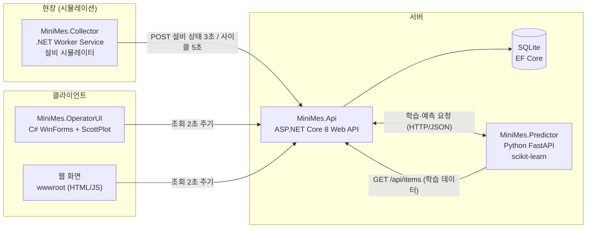
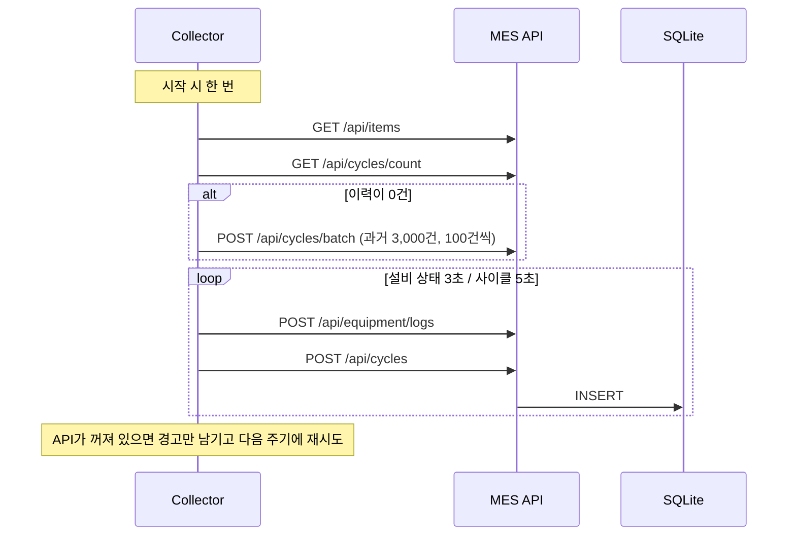
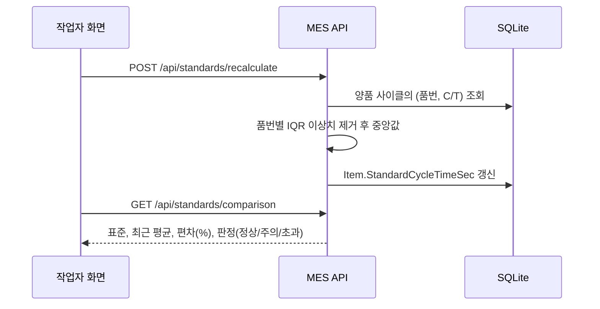
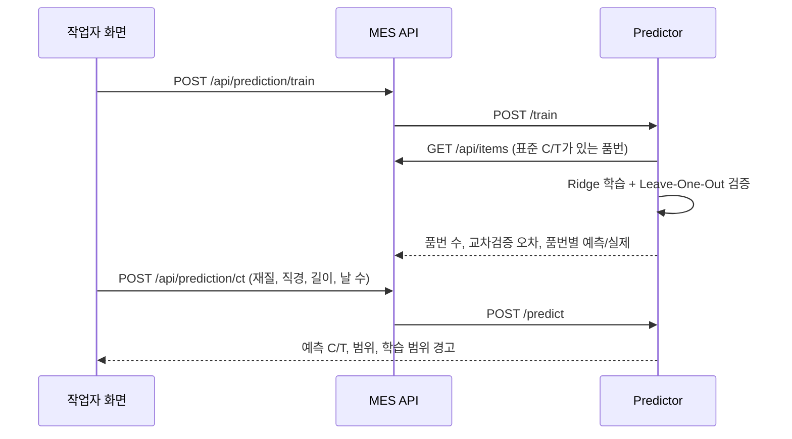

# MiniMes 아키텍처 설계서

절삭공구 생산 라인을 가정한 미니 MES의 구조와 설계 결정을 정리한 문서입니다. 화면과 사용 방법은 [README](../README.md)에 있습니다.

> 실제 회사의 공정 데이터는 사용할 수 없어서, 이 프로젝트의 품목·설비·생산 이력은 프로그램이 생성한 데이터입니다. 특정 회사의 시스템이나 데이터를 사용하지 않았습니다.

## 1. 목적과 범위

### 해결하려는 문제
생산 현장에서 같은 품번의 Cycle Time(C/T)이 설비와 시점에 따라 흔들리고, 불량이 났을 때 어떤 공정 조건이 원인인지 찾기 어렵다.

### 목표 (기능 요구사항)
| # | 목표 | 산출물 |
|---|---|---|
| G1 | 기존 품번의 C/T를 표준화한다 | 품번별 표준 C/T, 실적과의 편차 판정 |
| G2 | 신규 품번의 C/T를 예측한다 | 품번 사양 기반 예측값과 예상 오차 |
| G3 | 양/불 생산 시 PLC ACT값을 분석한다 | 양품 조업범위, 불량과 관련 있는 변수 순위 |

### 범위 밖 (이번 버전에서 하지 않는 것)
실제 PLC/OPC-UA 연동(시뮬레이터로 대체), 인증/권한, 다중 공장, 고가용성 구성, 작업지시 승인 워크플로우.

## 2. 시스템 구성



### 구성요소와 책임

| 구성요소 | 기술 | 책임 | 하지 않는 일 |
|---|---|---|---|
| **MiniMes.Api** | ASP.NET Core 8, EF Core | 데이터 저장·조회, 표준화와 ACT 분석 계산, 예측 요청 중계, 웹 화면 제공 | 모델 학습 |
| **MiniMes.Collector** | .NET Worker Service | 설비 상태와 가공 사이클 생성, API 전송, 과거 이력 1회 생성 | DB 직접 접근 |
| **MiniMes.Predictor** | FastAPI, scikit-learn | 신규 품번 C/T 예측 모델 학습과 추론 | 데이터 저장 |
| **MiniMes.OperatorUI** | WinForms, ScottPlot | 작업자용 화면 3개, 문서용 화면 캡처 | 비즈니스 계산(통계는 표시용 요약만) |
| **wwwroot** | HTML/JS | 브라우저용 간단 화면 | - |

### 구성 원칙
1. **화면은 MES API만 호출한다.** 예측 서버와 DB 위치를 화면이 몰라도 되고, 나중에 서버 구성이 바뀌어도 화면은 그대로다.
2. **수집기도 API를 통해서만 저장한다.** DB 스키마가 바뀌어도 수집기는 영향받지 않고, 검증 규칙이 한곳(API)에 모인다.
3. **무거운 연산은 기술 특성에 맞는 곳에서 한다.** 통계/집계는 API(.NET), 머신러닝은 Python.

## 3. 주요 데이터 흐름

### 3.1 수집


### 3.2 표준 C/T 계산과 비교


### 3.3 신규 품번 예측


### 3.4 ACT 분석
화면이 `GET /api/cycles`로 기간별 사이클을 가져와 조업범위(5~95% 분위수)와 분포를 그리고, `GET /api/analysis/act`로 변수별 불량 관련도(Cohen's d)를 받는다.

## 4. 데이터 모델

ERD는 [README의 데이터 모델](../README.md#데이터-모델-erd)에 있습니다. 설계상 결정만 정리합니다.

| 결정 | 이유 |
|---|---|
| `ProductionCycle`은 가공 1회당 1행, `Item`과는 FK 없이 `ItemCode`로 연결 | 이력이 매우 빠르게 쌓이는 테이블이라 분석(품번·기간 조회)을 단순하고 빠르게 유지. 인덱스는 `(ItemCode, StartedAt)`, `IsGood` |
| `EquipmentLog`는 설비 상태 시계열, `ProductionCycle`과 분리 | 3초 단위 원시 상태와 사이클 단위 요약은 조회 패턴과 보관 기간이 다름 |
| ACT 값은 사이클 단위 요약(평균/최대)으로 저장 | 원시 신호 전체를 저장하지 않고도 양/불 비교에 필요한 정보를 확보 |
| `WorkOrder → Lot → ProcessResult`는 정규화된 1:N | 전형적인 MES 추적 구조 (LOT 추적) |
| 열거형(상태)은 문자열로 저장 | DB에서 직접 조회할 때 읽기 쉽고, 값 순서 변경에 안전 |

## 5. 핵심 알고리즘

### 5.1 C/T 표준화
1. 양품 사이클의 C/T만 사용한다 (불량은 비정상 가공이라 값이 왜곡될 수 있음).
2. 품번별로 Q1 − 1.5×IQR ~ Q3 + 1.5×IQR 밖의 값(셋업 지연 등)을 제거한다.
3. 남은 값의 **중앙값**을 표준 C/T로 저장한다. 최소 표본 수(기본 30) 미만 품번은 건너뛴다.

판정 기준: 최근 양품 20건 평균과 표준의 편차가 ±5% 이내 정상, ±10% 이내 주의, 초과는 초과.

### 5.2 ACT 분석
- 품번마다 정상 부하와 RPM이 다르므로, **품번별 양품 평균과 표준편차로 z-score를 만든 뒤** 양품과 불량을 비교한다. (그렇지 않으면 난삭재가 불량이 많다는 이유만으로 부하가 불량과 관련 있어 보이는 착시가 생긴다.)
- 변수별로 Cohen's d(효과 크기: 0.2 약함 / 0.5 중간 / 0.8 이상 강함)와 ±3σ 관리한계 이탈률을 계산한다.

### 5.3 신규 품번 C/T 예측
- 입력: 재질(원-핫), 직경, 절삭 길이, 날 수. 출력: 로그 C/T를 예측한 뒤 지수 변환.
- 모델: Ridge 회귀. 학습 품번이 12개 안팎이라 복잡한 모델은 과적합 위험이 크고, CT에는 재질 계수가 곱해지는 구조라 로그를 취하면 선형에 가까워진다.
- 평가: Leave-One-Out 교차검증(품번 하나를 빼고 학습해 그 품번을 예측)의 평균 절대 백분율 오차로 성능을 재고, 규제 강도(alpha)도 이 오차가 가장 작은 값으로 고른다.
- 방어: 학습 범위를 벗어난 사양은 경고를 함께 반환하고, 학습에 없는 재질은 거부한다.

## 6. API 설계 원칙

- REST 스타일, JSON(camelCase). 영역별로 `/api/{영역}`.
- 요청은 **DTO(record)** 로 받아 서버가 관리하는 값(Id, 상태, 생성 시각)을 클라이언트가 지정하지 못하게 한다.
- 검증은 어노테이션(`[Required]`, `[Range]`)으로 하고 실패하면 400.
- 상태 코드: 없는 리소스 404, 중복 키 409, 예측 서버 연결 실패 503, 모델 미학습 409.
- 예측 서버의 오류는 `{ "detail": "..." }` 형태로 그대로 화면에 전달한다.
- 엔드포인트 목록은 [README](../README.md#api-목록), 실행 중에는 `/swagger`에서 확인한다.

## 7. 장애와 비기능 요구

| 상황 | 동작 |
|---|---|
| API가 꺼짐 | 수집기는 죽지 않고 다음 주기에 재시도. 화면은 상단에 연결 실패를 표시하고 켜지면 자동 복구 |
| 수집기가 꺼짐 | 설비 카드가 15초 후 "수집 중단"으로 표시됨 |
| 예측 서버가 꺼짐 | 예측 기능만 503 안내. 표준화, ACT 분석, 대시보드는 정상 동작 |
| 모델이 학습되지 않음 | 예측 요청에 409와 학습 안내 문구 반환. 학습은 표준 C/T 재계산 후 가능 |
| 중복 입력 | 작업지시 번호, LOT 번호, 품목 코드는 유니크 인덱스와 409 응답으로 방지 |

성능과 용량: 화면은 최근 5,000건 기준으로 조회하며, 사이클 조회 API는 최대 5,000건으로 제한한다. 수집기 기본 주기는 데이터가 과도하게 쌓이지 않도록 5초다.

## 8. 설계 결정 기록

| 결정 | 선택 | 대안 | 이유와 감수한 점 |
|---|---|---|---|
| DB | SQLite (EF Core) | SQL Server | 설치 없이 바로 실행. 공급자만 바꾸면 되도록 EF Core를 사용. 동시 쓰기 성능과 운영 기능은 포기 |
| 수집기의 저장 경로 | API 경유 | DB 직접 쓰기 | 검증과 스키마를 API에 모으기 위해. HTTP 호출 비용이 늘어남 |
| 예측 서버 | Python 분리 | ML.NET | 머신러닝 생태계와 기존 경험을 활용. 프로세스가 하나 더 늘어남 |
| 예측 모델 | Ridge + 로그 변환 | 트리 계열, 신경망 | 표본이 12개라 단순한 모델이 안정적이고 해석이 쉬움 |
| 화면 | WinForms | 웹, WPF | 현장 PC에 설치해 쓰는 Windows 프로그램 요구. Windows 전용이 되는 점 수용 |
| 차트 | ScottPlot + 직접 그린 컨트롤 | 다른 차트 라이브러리 | 시계열과 분포는 ScottPlot, 히트맵과 조업범위 막대는 요구에 맞게 직접 구현 |
| 통계 계산 위치 | API(표준화, ACT 분석), 화면(조업범위 표시용) | 전부 서버 | 업무 판단은 서버에서 일관되게, 화면의 분위수는 표시용 |
| 시드와 마이그레이션 | 개발 환경에서 자동 적용 | 수동 | 처음 실행을 쉽게. 운영 환경에서는 사용하지 않음 |

## 9. 한계와 확장 계획

현재 한계
- 학습 품번이 12개뿐이라 품번별 예측 오차가 최대 약 7%까지 나온다.
- 인증이 없어 누구나 API를 호출할 수 있다.
- 화면의 통계(분위수, 이상치 개수)는 최근 5,000건 기준 근사값이다.

확장 계획
| 단계 | 내용 |
|---|---|
| 1 | SQL Server 전환 (EF Core 공급자 교체, 마이그레이션 재생성, 인덱스 점검) |
| 2 | 시뮬레이터를 OPC-UA 클라이언트로 교체해 실제 설비 연동 |
| 3 | 실시간 ACT가 ±3σ를 벗어나면 화면에 경고 표시 |
| 4 | 인증/권한, 감사 로그, 컨테이너 배포 |
| 5 | .NET 통계 로직 단위 테스트 추가 (현재는 예측 모델만 7건) |

## 10. 솔루션 구조

```
MiniMes/
├─ MiniMes.Api/            ASP.NET Core Web API (Controllers, Models, Data, Analysis, wwwroot)
├─ MiniMes.Collector/      .NET Worker Service (설비 시뮬레이터)
├─ MiniMes.OperatorUI/     WinForms 작업자 프로그램 (Screens, Controls)
├─ MiniMes.Predictor/      Python FastAPI 예측 서버 (app, tests)
├─ docs/                   문서와 화면 이미지
├─ scripts/                전체 실행 스크립트
└─ MiniMes.sln, global.json
```
